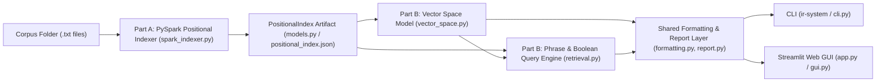

# Technology Version PySpark Information Retrieval System — Part C Project Report

- **Assigned Domain:** Technology (`data/2. Technology/`, Documents `d1.txt`–`d10.txt`)
- **Reference Specification:** [IR_Project_Requirements_and_Expected_Outputs_Fall2026.pdf](IR_Project_Requirements_and_Expected_Outputs_Fall2026.pdf) (Pages 3 and 11–15) and [Information_Retrieval_Project_Coversheet.pdf](Information_Retrieval_Project_Coversheet.pdf)
- **Domain Glossary:** [GLOSSARY.md](../GLOSSARY.md)
- **Architecture Decision Records:** [ADR 0001](adr/0001-pyspark-indexing-python-retrieval.md), [ADR 0002](adr/0002-case-sensitive-boolean-operators.md), [ADR 0003](adr/0003-streamlit-web-gui.md)

---

## 1. System Architecture

The system implements a clean, modular pipeline that separates distributed/local **Part A** Positional Index construction in **Apache Spark (PySpark)** from **Part B** vector-space weighting, phrase/Boolean query processing, and cosine similarity ranking in pure Python, while sharing a single presentation and Markdown export layer across both the **CLI** and the **Streamlit Web GUI**.



### Architectural Components & Design Decisions

1. **Part A vs. Part B Separation ([ADR 0001](adr/0001-pyspark-indexing-python-retrieval.md))**:
   - **Part A (`src/ir_system/spark_indexer.py`)** runs PySpark (`local[*]`) exclusively to ingest `.txt` Documents, tokenize text, assign 1-based Positions, and build the sorted **Positional Index**. It also supports serializing (`export_positional_index`) and reloading (`load_positional_index`) `positional_index.json`.
   - **Part B (`src/ir_system/vector_space.py` and `src/ir_system/retrieval.py`)** consumes the `PositionalIndex` directly in pure Python to compute **Raw TF**, **Weighted TF**, **DF**, **IDF**, **TF-IDF Weight**, **Document Vector Length**, **Normalized TF-IDF**, exact **Phrase Query** matching, **Boolean Query** evaluation (`AND` / `AND NOT`), **Query Vector** construction, and cosine **Similarity Score** ranking.
   - Separating Part A from Part B mirrors the project specification (*"Part B: 1. Use the output of the Positional Index from Part A"*), keeps Spark's indexing role crisp and inspectable, and guarantees sub-millisecond interactive query execution without paying Spark JVM startup overhead on every query.
2. **Domain Data Model (`src/ir_system/models.py`)**:
   - Defines immutable `DocumentRecord` and `PositionalIndex` dataclasses alongside `natural_sort_key` so arbitrary Document IDs sort naturally (`d1, d2, ..., d10`, or `doc_2, doc_10`) rather than lexicographically (`d1, d10, d2`).
3. **Case-Sensitive Boolean Query Grammar ([ADR 0002](adr/0002-case-sensitive-boolean-operators.md))**:
   - Only uppercase `AND` and `AND NOT` act as Boolean operators; lowercase `and` / `not` remain ordinary searchable Tokens (critical because `d5.txt` contains literal `and` at Position `8`).
   - Supports four explicit modes (`auto`, `term`, `phrase`, `boolean`) via `parse_query` and `execute_query`.
4. **Shared Presentation & Report Layer (`src/ir_system/formatting.py`, `src/ir_system/report.py`)**:
   - Formats pipe-delimited terminal tables, reusable row/header tuples for Pandas DataFrames, and complete GitHub-Flavored Markdown reports (`report.md`), ensuring identical numerical precision (`4` decimals for weights/scores, `6` decimals for Query Vector Lengths, `'0'` for zero matrix cells) across CLI and GUI.
5. **Dual Interfaces: CLI (`src/ir_system/cli.py`) & Bonus Streamlit Web GUI (`app.py`, `src/ir_system/gui.py`, [ADR 0003](adr/0003-streamlit-web-gui.md))**:
   - The CLI (`uv run ir-system`) supports default Technology Corpus execution, custom `--corpus` paths, repeatable `--query` and `--mode` flags, `--export-dir`, and `--from-index` offline reload.
   - The Streamlit Web GUI (`uv run streamlit run app.py`) caches the `SparkSession` via `@st.cache_resource` so Spark initializes once, supports local folder import and multi-file upload, exposes interactive query mode selection and quick-fill buttons, displays searchable calculation tabs, and provides one-click `report.md` download.
6. **Dataset Flexibility (Bonus Feature)**:
   - Zero corpus texts, vocabulary terms, matrices, or rankings are hardcoded anywhere in `src/ir_system/`. Any folder of `.txt` files with arbitrary document counts ($N \ge 1$) and arbitrary filenames can be indexed and queried; non-`.txt` files are ignored and empty/whitespace-only `.txt` files are skipped with explicit warnings.

---

## 2. Apache Spark's Role in Part A

In `src/ir_system/spark_indexer.py`, Apache Spark (`pyspark==4.0.1` running in `local[*]` mode) is responsible for transforming raw Document text into the sorted **Positional Index**:

1. **Windows Execution & `PYSPARK_PYTHON` / `winutils.exe` Handling**:
   - Before building the `SparkSession`, `_configure_pyspark_python()` sets `PYSPARK_PYTHON` and `PYSPARK_DRIVER_PYTHON` to `sys.executable`. When the workspace or virtual environment path on Windows contains spaces or `&` (such as `INFORMATION STORAGE & RETRIEVAL`), `_ensure_safe_windows_dir()` creates a deterministic space-free NTFS directory junction (`mklink /J`) in `%TEMP%` (`pyspark_venv_<hash>` and `pyspark_home_<hash>`) so Spark's `cmd.exe` worker/driver subprocesses resolve paths without quoting errors.
   - `create_spark_session()` configures `spark.driver.host=127.0.0.1`, `spark.driver.bindAddress=127.0.0.1`, `spark.ui.enabled=false`, `spark.sql.shuffle.partitions=4`, and `spark.sparkContext.setLogLevel("ERROR")`.
   - `_read_corpus_files()` validates the Corpus directory, reads non-empty UTF-8 `.txt` files in natural filename order (recording warnings for empty/whitespace-only `.txt` files and ignoring non-`.txt` files), and passes `(doc_id, text)` tuples into `active_spark.createDataFrame(raw_documents, schema=_DOCUMENT_SCHEMA)`. Reading `.txt` files safely before `createDataFrame` prevents Hadoop `winutils.exe` directory-glob failures on Windows without sacrificing Spark DataFrame execution for tokenization and aggregation.
2. **Tokenization & 1-Based Position Assignment**:
   - Inside `build_positional_index()`, the Spark DataFrame pipeline applies:
     ```python
     docs_df.select(
         F.col("doc_id"),
         F.posexplode(
             F.split(
                 F.trim(F.regexp_replace(F.lower(F.col("text")), r"\s+", " ")),
                 " ",
             )
         ).alias("zero_pos", "term"),
     )
     .filter(F.col("term") != "")
     .withColumn("position", F.col("zero_pos") + F.lit(1))
     ```
   - `F.lower` lowercases every Document without removing stop words or applying stemming/lemmatization, preserving exact Tokens (such as `and` in `d5`, `support` vs. `supports`, `improve` vs. `improves`).
   - `F.regexp_replace(..., r"\s+", " ")`, `F.trim`, and `F.split(..., " ")` produce an ordered Token array per Document.
   - `F.posexplode` explodes each Document's Token array into `(doc_id, zero_pos, term)` rows, and `F.col("zero_pos") + F.lit(1)` converts 0-based array indices into **1-based Positions**.
3. **Positional Index Aggregation & Sorting**:
   - Spark groups by `("term", "doc_id")`, aggregates Positions using `F.sort_array(F.collect_list("position")).alias("positions")`, orders by `("term", "doc_id")`, and collects the resulting postings rows back to the Python driver.
   - Finally, `build_positional_index()` constructs the `PositionalIndex` with alphabetically sorted Terms, naturally sorted Document IDs (`natural_sort_key`), ascending 1-based Position tuples, exact per-Document `word_count`, and total indexing duration.

---

## 3. Algorithms & Mathematical Formulas

All terminology follows [GLOSSARY.md](../GLOSSARY.md). Let $N$ be the number of active non-empty Documents in the **Corpus** and $V$ be the sorted set of unique vocabulary **Terms**.

### 3.1 Positional Index (Part A)

Each **Document** $d$ is tokenized into an ordered sequence of lowercased, whitespace-delimited **Tokens** $w_1, w_2, \dots, w_L$ without stop-word removal or stemming. The **Positional Index** maps each unique **Term** $t \in V$ to every Document containing $t$ and its ordered list of 1-based **Positions**:

$$\text{Postings}(t) = \{ d \mapsto [p_1, p_2, \dots, p_k] \mid 1 \le p_1 < p_2 < \dots < p_k \le L_d \}$$

### 3.2 Term Weighting & Vector-Space Model (Part B)

1. **Raw TF** — integer count of occurrences of Term $t$ in Document $d$:
   $$\text{RawTF}(t, d) = |\text{Postings}(t)[d]|$$
2. **Weighted TF** — base-10 log-scaled term frequency:
   $$\text{WeightedTF}(t, d) = \begin{cases} 1 + \log_{10}(\text{RawTF}(t, d)) & \text{if } \text{RawTF}(t, d) > 0 \\ 0 & \text{otherwise} \end{cases}$$
3. **DF (Document Frequency)** — count of distinct Documents containing Term $t$:
   $$\text{DF}(t) = |\{ d \in \text{Corpus} : \text{RawTF}(t, d) > 0 \}|$$
4. **IDF (Inverse Document Frequency)** — base-10 rarity weight across the Corpus of $N$ Documents:
   $$\text{IDF}(t) = \begin{cases} \log_{10}\!\left(\dfrac{N}{\text{DF}(t)}\right) & \text{if } \text{DF}(t) > 0 \\ 0 & \text{otherwise} \end{cases}$$
5. **TF-IDF Weight** — unnormalized weight of Term $t$ in Document $d$:
   $$w_{t, d} = \text{WeightedTF}(t, d) \times \text{IDF}(t)$$
6. **Document Vector Length** — Euclidean ($L_2$) norm of Document $d$'s TF-IDF Weight vector:
   $$\|d\|_2 = \sqrt{\sum_{t \in V} w_{t, d}^2}$$
7. **Normalized TF-IDF** — unit-length Document vector component:
   $$\hat{w}_{t, d} = \begin{cases} \dfrac{w_{t, d}}{\|d\|_2} & \text{if } \|d\|_2 > 0 \\ 0 & \text{otherwise} \end{cases}$$

### 3.3 Phrase Queries, Boolean Queries, Query Vector, and Cosine Similarity

1. **Phrase Query Matching (`match_phrase`)**:
   Given an ordered sequence of $m$ Tokens $P = (q_1, q_2, \dots, q_m)$, Document $d$ matches at 1-based starting Position $p$ if and only if:
   $$\forall k \in \{0, 1, \dots, m - 1\}, \quad (p + k) \in \text{Postings}(q_{k+1})[d]$$
   Each match yields starting Position $p$ and inclusive token range $p\text{-}(p + m - 1)$. A single-token search ($m = 1$) is handled as a 1-token Phrase Query with range $p\text{-}p$.
2. **Boolean Query Evaluation (`AND` / `AND NOT`)**:
   Raw queries are split on case-sensitive uppercase `AND` and `AND NOT` before lowercasing each clause (`parse_query`):
   - **Positive Clause**: any Phrase Query operand not preceded by `AND NOT`.
   - **Excluded Clause**: a Phrase Query operand preceded by `AND NOT`.
   - Starting from the first clause's matched Document set $M_{\text{active}} = M_1$, subsequent clauses apply left-to-right:
     - `AND`: $M_{\text{active}} \leftarrow M_{\text{active}} \cap M_i$
     - `AND NOT`: $M_{\text{active}} \leftarrow M_{\text{active}} \setminus M_i$
3. **Query Vector**:
   Built strictly from Tokens appearing in **Positive Clauses** $q^+$ (Excluded Clauses filter Document sets without adding Terms to the Query Vector):
   $$\text{QueryRawTF}(t, q) = \text{occurrences of } t \text{ in } q^+$$
   $$\text{QueryWeightedTF}(t, q) = \begin{cases} 1 + \log_{10}(\text{QueryRawTF}(t, q)) & \text{if } \text{QueryRawTF}(t, q) > 0 \\ 0 & \text{otherwise} \end{cases}$$
   $$w_{t, q} = \text{QueryWeightedTF}(t, q) \times \text{IDF}(t), \qquad \|q\|_2 = \sqrt{\sum_{t \in q^+} w_{t, q}^2}, \qquad \hat{w}_{t, q} = \begin{cases} \dfrac{w_{t, q}}{\|q\|_2} & \text{if } \|q\|_2 > 0 \\ 0 & \text{otherwise} \end{cases}$$
   (Out-of-vocabulary Terms receive $\text{IDF}(t) = 0$.)
4. **Similarity Score & Ranking**:
   For each matched Document $d \in M_{\text{active}}$, the cosine **Similarity Score** is the dot product between the normalized Query Vector and the Document's Normalized TF-IDF vector:
   $$\text{Similarity}(q, d) = \hat{q} \cdot \hat{d} = \sum_{t \in q^+} \hat{w}_{t, q} \cdot \hat{w}_{t, d}$$
   Matched Documents are ranked in descending order of $\text{Similarity}(q, d)$, breaking exact ties using natural Document ID order (`natural_sort_key`).

---

## 4. Dependency Justification

Every dependency declared in [pyproject.toml](../pyproject.toml) serves a specific, bounded role:

| Package | Group | Version Constraint | Justification |
| --- | --- | --- | --- |
| `pyspark` | Core runtime | `==4.0.1` | Mandatory Part A engine for Spark DataFrame ingestion, lowercasing, whitespace splitting, `posexplode` 1-based position generation, and Positional Index aggregation (`local[*]`). Pinned to `4.0.1` for reproducible execution with Python `3.10.20` and Java `17`. |
| `streamlit` | Core runtime | `>=1.65.0` | Implements the **+1.0 bonus GUI** ([ADR 0003](adr/0003-streamlit-web-gui.md)) with minimal UI boilerplate: interactive folder/file dataset import, 4-mode radio selection, quick-fill query controls, searchable/scrollable matrix tables, `@st.cache_resource` Spark caching, and Markdown report downloads. Core Part A, Part B, and CLI modules remain 100% independent of Streamlit. |
| `pandas` | Core runtime | `>=2.3.3` | Used directly by `src/ir_system/gui.py` (`_table_to_dataframe`) to convert shared `(headers, rows)` formatting tuples into structured `DataFrame` objects for Streamlit's searchable/scrollable `st.dataframe` tables; declared explicitly in `pyproject.toml` per [ADR 0003](adr/0003-streamlit-web-gui.md). |
| `pytest` | `dev` group | latest compatible | Automated verification framework validating Part A Positional Index construction, all Part B matrices against PDF pages 11–15 within `1e-4`, phrase/Boolean semantics, edge cases, CLI export/reload round-trips, Dataset Flexibility, and headless Streamlit `AppTest` behavior. |

---

## 5. Windows Setup & Execution Instructions

### 5.1 Prerequisites & Installation

- **Operating System:** Windows 10 / 11 (PowerShell)
- **Java:** Java 17 JDK (verified with OpenJDK Temurin `17.0.16+8` on `PATH` / `JAVA_HOME`)
- **Python:** Python `3.10.20` (pinned in `.python-version`, provisioned automatically by `uv`)
- **Package Manager:** `uv`

From the repository root, synchronize the virtual environment and install all dependencies:

```powershell
uv sync
```

### 5.2 Running the Command-Line Interface (CLI)

1. **Run the full Technology Version pipeline** (Part A Positional Index, all Part B matrices, and all 4 assigned Technology queries):
   ```powershell
   uv run ir-system
   ```
2. **Export Part A `positional_index.json` and full Markdown `report.md`**:
   ```powershell
   uv run ir-system --export-dir output/part_c_capture
   ```
3. **Run custom queries with explicit modes (`auto`, `term`, `phrase`, `boolean`)**:
   ```powershell
   uv run ir-system --query "machine" --mode term
   uv run ir-system --query "data science and machine learning" --mode phrase
   uv run ir-system --query "machine learning AND models AND NOT data science" --mode boolean
   ```
4. **Reload an exported Part A index without restarting Spark**:
   ```powershell
   uv run ir-system --from-index output/part_c_capture/positional_index.json --query "machine learning"
   ```
5. **Run on an arbitrary `.txt` Corpus (Dataset Flexibility)**:
   ```powershell
   uv run ir-system --corpus "path\to\custom_corpus" --query "your search query" --mode auto
   ```

### 5.3 Running the Streamlit Web GUI

Launch the interactive Web GUI:

```powershell
uv run streamlit run app.py
```

**GUI Walkthrough:**
1. **Startup:** The app automatically indexes `data/2. Technology` once using a cached `SparkSession` (`N = 10` Documents, `27` Terms, `64` Tokens).
2. **Sidebar — Corpus Import:**
   - Enter any local folder path under **Local Corpus Folder Path** and click **Load Folder**, or choose **Upload Mode** (`Select .txt files` or `Select a folder`) to upload `.txt` files or a Corpus folder. Non-`.txt` files are ignored and empty `.txt` files are skipped with warnings; click **Reset to Technology** at any time to restore the default Corpus.
3. **Query & Retrieval Panel:**
   - Choose a **Query Mode** (`Auto`, `Term Search`, `Exact Phrase`, `Boolean (AND / AND NOT)`).
   - Type a query into **Enter Query** or click one of the four quick-fill Technology buttons (`machine learning`, `data science`, `machine learning AND data science`, `machine learning AND NOT data science`).
   - Inspect matched Documents, starting Positions, inclusive token ranges, Query Vector Length (6 decimals), normalized Query Vector weights, cosine Similarity Scores, and final ranking.
4. **Inspection Tabs & Export:**
   - Browse **Documents**, **Positional Index** (with live Term substring filtering), **Raw TF & Weighted TF**, **DF & IDF**, and **TF-IDF / Document Vector Lengths / Normalized TF-IDF**, or click **Download Report (Markdown)** to save `report.md`.

### 5.4 Running the Automated Verification Suite

```powershell
uv run pytest -v
```

---

## 6. Live-Generated Technology Version Outputs

All tables and query results below were generated live from the Technology Corpus (`data/2. Technology/`) by executing:

```powershell
uv run ir-system --export-dir output/part_c_capture
```

### Corpus Summary
- **Documents (`N`)**: 10
- **Vocabulary Terms**: 27
- **Total Tokens**: 64
- **Corpus Path**: `data\2. Technology`

### Part A — Positional Index

#### Documents (`N = 10`)

| File | Exact document text | Word count |
| --- | --- | --- |
| d1 | machine learning | 2 |
| d2 | machine learning improves data processing | 5 |
| d3 | data science tools support analysis | 5 |
| d4 | artificial intelligence powers smart systems | 5 |
| d5 | machine learning machine models support data science and machine learning | 10 |
| d6 | cloud computing supports data storage | 5 |
| d7 | artificial intelligence uses machine learning models | 6 |
| d8 | data science explores data analytics through research computing systems | 9 |
| d9 | cloud computing cloud storage supports data systems | 7 |
| d10 | machine learning models improve machine learning applications research data systems | 10 |

#### Positional Index (27 Terms)

| Term | Document IDs and 1-based positions |
| --- | --- |
| analysis | d3: 5 |
| analytics | d8: 5 |
| and | d5: 8 |
| applications | d10: 7 |
| artificial | d4: 1; d7: 1 |
| cloud | d6: 1; d9: 1, 3 |
| computing | d6: 2; d8: 8; d9: 2 |
| data | d2: 4; d3: 1; d5: 6; d6: 4; d8: 1, 4; d9: 6; d10: 9 |
| explores | d8: 3 |
| improve | d10: 4 |
| improves | d2: 3 |
| intelligence | d4: 2; d7: 2 |
| learning | d1: 2; d2: 2; d5: 2, 10; d7: 5; d10: 2, 6 |
| machine | d1: 1; d2: 1; d5: 1, 3, 9; d7: 4; d10: 1, 5 |
| models | d5: 4; d7: 6; d10: 3 |
| powers | d4: 3 |
| processing | d2: 5 |
| research | d8: 7; d10: 8 |
| science | d3: 2; d5: 7; d8: 2 |
| smart | d4: 4 |
| storage | d6: 5; d9: 4 |
| support | d3: 4; d5: 5 |
| supports | d6: 3; d9: 5 |
| systems | d4: 5; d8: 9; d9: 7; d10: 10 |
| through | d8: 6 |
| tools | d3: 3 |
| uses | d7: 3 |

### Part B — Vector-Space Model

#### Raw TF

| Term | d1 | d2 | d3 | d4 | d5 | d6 | d7 | d8 | d9 | d10 |
| --- | --- | --- | --- | --- | --- | --- | --- | --- | --- | --- |
| analysis | 0 | 0 | 1.0000 | 0 | 0 | 0 | 0 | 0 | 0 | 0 |
| analytics | 0 | 0 | 0 | 0 | 0 | 0 | 0 | 1.0000 | 0 | 0 |
| and | 0 | 0 | 0 | 0 | 1.0000 | 0 | 0 | 0 | 0 | 0 |
| applications | 0 | 0 | 0 | 0 | 0 | 0 | 0 | 0 | 0 | 1.0000 |
| artificial | 0 | 0 | 0 | 1.0000 | 0 | 0 | 1.0000 | 0 | 0 | 0 |
| cloud | 0 | 0 | 0 | 0 | 0 | 1.0000 | 0 | 0 | 2.0000 | 0 |
| computing | 0 | 0 | 0 | 0 | 0 | 1.0000 | 0 | 1.0000 | 1.0000 | 0 |
| data | 0 | 1.0000 | 1.0000 | 0 | 1.0000 | 1.0000 | 0 | 2.0000 | 1.0000 | 1.0000 |
| explores | 0 | 0 | 0 | 0 | 0 | 0 | 0 | 1.0000 | 0 | 0 |
| improve | 0 | 0 | 0 | 0 | 0 | 0 | 0 | 0 | 0 | 1.0000 |
| improves | 0 | 1.0000 | 0 | 0 | 0 | 0 | 0 | 0 | 0 | 0 |
| intelligence | 0 | 0 | 0 | 1.0000 | 0 | 0 | 1.0000 | 0 | 0 | 0 |
| learning | 1.0000 | 1.0000 | 0 | 0 | 2.0000 | 0 | 1.0000 | 0 | 0 | 2.0000 |
| machine | 1.0000 | 1.0000 | 0 | 0 | 3.0000 | 0 | 1.0000 | 0 | 0 | 2.0000 |
| models | 0 | 0 | 0 | 0 | 1.0000 | 0 | 1.0000 | 0 | 0 | 1.0000 |
| powers | 0 | 0 | 0 | 1.0000 | 0 | 0 | 0 | 0 | 0 | 0 |
| processing | 0 | 1.0000 | 0 | 0 | 0 | 0 | 0 | 0 | 0 | 0 |
| research | 0 | 0 | 0 | 0 | 0 | 0 | 0 | 1.0000 | 0 | 1.0000 |
| science | 0 | 0 | 1.0000 | 0 | 1.0000 | 0 | 0 | 1.0000 | 0 | 0 |
| smart | 0 | 0 | 0 | 1.0000 | 0 | 0 | 0 | 0 | 0 | 0 |
| storage | 0 | 0 | 0 | 0 | 0 | 1.0000 | 0 | 0 | 1.0000 | 0 |
| support | 0 | 0 | 1.0000 | 0 | 1.0000 | 0 | 0 | 0 | 0 | 0 |
| supports | 0 | 0 | 0 | 0 | 0 | 1.0000 | 0 | 0 | 1.0000 | 0 |
| systems | 0 | 0 | 0 | 1.0000 | 0 | 0 | 0 | 1.0000 | 1.0000 | 1.0000 |
| through | 0 | 0 | 0 | 0 | 0 | 0 | 0 | 1.0000 | 0 | 0 |
| tools | 0 | 0 | 1.0000 | 0 | 0 | 0 | 0 | 0 | 0 | 0 |
| uses | 0 | 0 | 0 | 0 | 0 | 0 | 1.0000 | 0 | 0 | 0 |

#### Weighted TF (`1 + log10(TF)`)

| Term | d1 | d2 | d3 | d4 | d5 | d6 | d7 | d8 | d9 | d10 |
| --- | --- | --- | --- | --- | --- | --- | --- | --- | --- | --- |
| analysis | 0 | 0 | 1.0000 | 0 | 0 | 0 | 0 | 0 | 0 | 0 |
| analytics | 0 | 0 | 0 | 0 | 0 | 0 | 0 | 1.0000 | 0 | 0 |
| and | 0 | 0 | 0 | 0 | 1.0000 | 0 | 0 | 0 | 0 | 0 |
| applications | 0 | 0 | 0 | 0 | 0 | 0 | 0 | 0 | 0 | 1.0000 |
| artificial | 0 | 0 | 0 | 1.0000 | 0 | 0 | 1.0000 | 0 | 0 | 0 |
| cloud | 0 | 0 | 0 | 0 | 0 | 1.0000 | 0 | 0 | 1.3010 | 0 |
| computing | 0 | 0 | 0 | 0 | 0 | 1.0000 | 0 | 1.0000 | 1.0000 | 0 |
| data | 0 | 1.0000 | 1.0000 | 0 | 1.0000 | 1.0000 | 0 | 1.3010 | 1.0000 | 1.0000 |
| explores | 0 | 0 | 0 | 0 | 0 | 0 | 0 | 1.0000 | 0 | 0 |
| improve | 0 | 0 | 0 | 0 | 0 | 0 | 0 | 0 | 0 | 1.0000 |
| improves | 0 | 1.0000 | 0 | 0 | 0 | 0 | 0 | 0 | 0 | 0 |
| intelligence | 0 | 0 | 0 | 1.0000 | 0 | 0 | 1.0000 | 0 | 0 | 0 |
| learning | 1.0000 | 1.0000 | 0 | 0 | 1.3010 | 0 | 1.0000 | 0 | 0 | 1.3010 |
| machine | 1.0000 | 1.0000 | 0 | 0 | 1.4771 | 0 | 1.0000 | 0 | 0 | 1.3010 |
| models | 0 | 0 | 0 | 0 | 1.0000 | 0 | 1.0000 | 0 | 0 | 1.0000 |
| powers | 0 | 0 | 0 | 1.0000 | 0 | 0 | 0 | 0 | 0 | 0 |
| processing | 0 | 1.0000 | 0 | 0 | 0 | 0 | 0 | 0 | 0 | 0 |
| research | 0 | 0 | 0 | 0 | 0 | 0 | 0 | 1.0000 | 0 | 1.0000 |
| science | 0 | 0 | 1.0000 | 0 | 1.0000 | 0 | 0 | 1.0000 | 0 | 0 |
| smart | 0 | 0 | 0 | 1.0000 | 0 | 0 | 0 | 0 | 0 | 0 |
| storage | 0 | 0 | 0 | 0 | 0 | 1.0000 | 0 | 0 | 1.0000 | 0 |
| support | 0 | 0 | 1.0000 | 0 | 1.0000 | 0 | 0 | 0 | 0 | 0 |
| supports | 0 | 0 | 0 | 0 | 0 | 1.0000 | 0 | 0 | 1.0000 | 0 |
| systems | 0 | 0 | 0 | 1.0000 | 0 | 0 | 0 | 1.0000 | 1.0000 | 1.0000 |
| through | 0 | 0 | 0 | 0 | 0 | 0 | 0 | 1.0000 | 0 | 0 |
| tools | 0 | 0 | 1.0000 | 0 | 0 | 0 | 0 | 0 | 0 | 0 |
| uses | 0 | 0 | 0 | 0 | 0 | 0 | 1.0000 | 0 | 0 | 0 |

#### DF and IDF

| Term | DF | IDF = log10(10 / DF) |
| --- | --- | --- |
| analysis | 1 | 1.0000 |
| analytics | 1 | 1.0000 |
| and | 1 | 1.0000 |
| applications | 1 | 1.0000 |
| artificial | 2 | 0.6990 |
| cloud | 2 | 0.6990 |
| computing | 3 | 0.5229 |
| data | 7 | 0.1549 |
| explores | 1 | 1.0000 |
| improve | 1 | 1.0000 |
| improves | 1 | 1.0000 |
| intelligence | 2 | 0.6990 |
| learning | 5 | 0.3010 |
| machine | 5 | 0.3010 |
| models | 3 | 0.5229 |
| powers | 1 | 1.0000 |
| processing | 1 | 1.0000 |
| research | 2 | 0.6990 |
| science | 3 | 0.5229 |
| smart | 1 | 1.0000 |
| storage | 2 | 0.6990 |
| support | 2 | 0.6990 |
| supports | 2 | 0.6990 |
| systems | 4 | 0.3979 |
| through | 1 | 1.0000 |
| tools | 1 | 1.0000 |
| uses | 1 | 1.0000 |

#### TF-IDF Matrix

| Term | d1 | d2 | d3 | d4 | d5 | d6 | d7 | d8 | d9 | d10 |
| --- | --- | --- | --- | --- | --- | --- | --- | --- | --- | --- |
| analysis | 0 | 0 | 1.0000 | 0 | 0 | 0 | 0 | 0 | 0 | 0 |
| analytics | 0 | 0 | 0 | 0 | 0 | 0 | 0 | 1.0000 | 0 | 0 |
| and | 0 | 0 | 0 | 0 | 1.0000 | 0 | 0 | 0 | 0 | 0 |
| applications | 0 | 0 | 0 | 0 | 0 | 0 | 0 | 0 | 0 | 1.0000 |
| artificial | 0 | 0 | 0 | 0.6990 | 0 | 0 | 0.6990 | 0 | 0 | 0 |
| cloud | 0 | 0 | 0 | 0 | 0 | 0.6990 | 0 | 0 | 0.9094 | 0 |
| computing | 0 | 0 | 0 | 0 | 0 | 0.5229 | 0 | 0.5229 | 0.5229 | 0 |
| data | 0 | 0.1549 | 0.1549 | 0 | 0.1549 | 0.1549 | 0 | 0.2015 | 0.1549 | 0.1549 |
| explores | 0 | 0 | 0 | 0 | 0 | 0 | 0 | 1.0000 | 0 | 0 |
| improve | 0 | 0 | 0 | 0 | 0 | 0 | 0 | 0 | 0 | 1.0000 |
| improves | 0 | 1.0000 | 0 | 0 | 0 | 0 | 0 | 0 | 0 | 0 |
| intelligence | 0 | 0 | 0 | 0.6990 | 0 | 0 | 0.6990 | 0 | 0 | 0 |
| learning | 0.3010 | 0.3010 | 0 | 0 | 0.3916 | 0 | 0.3010 | 0 | 0 | 0.3916 |
| machine | 0.3010 | 0.3010 | 0 | 0 | 0.4447 | 0 | 0.3010 | 0 | 0 | 0.3916 |
| models | 0 | 0 | 0 | 0 | 0.5229 | 0 | 0.5229 | 0 | 0 | 0.5229 |
| powers | 0 | 0 | 0 | 1.0000 | 0 | 0 | 0 | 0 | 0 | 0 |
| processing | 0 | 1.0000 | 0 | 0 | 0 | 0 | 0 | 0 | 0 | 0 |
| research | 0 | 0 | 0 | 0 | 0 | 0 | 0 | 0.6990 | 0 | 0.6990 |
| science | 0 | 0 | 0.5229 | 0 | 0.5229 | 0 | 0 | 0.5229 | 0 | 0 |
| smart | 0 | 0 | 0 | 1.0000 | 0 | 0 | 0 | 0 | 0 | 0 |
| storage | 0 | 0 | 0 | 0 | 0 | 0.6990 | 0 | 0 | 0.6990 | 0 |
| support | 0 | 0 | 0.6990 | 0 | 0.6990 | 0 | 0 | 0 | 0 | 0 |
| supports | 0 | 0 | 0 | 0 | 0 | 0.6990 | 0 | 0 | 0.6990 | 0 |
| systems | 0 | 0 | 0 | 0.3979 | 0 | 0 | 0 | 0.3979 | 0.3979 | 0.3979 |
| through | 0 | 0 | 0 | 0 | 0 | 0 | 0 | 1.0000 | 0 | 0 |
| tools | 0 | 0 | 1.0000 | 0 | 0 | 0 | 0 | 0 | 0 | 0 |
| uses | 0 | 0 | 0 | 0 | 0 | 0 | 1.0000 | 0 | 0 | 0 |

#### Document Vector Lengths

| Document | Vector length |
| --- | --- |
| d1 | 0.4257 |
| d2 | 1.4850 |
| d3 | 1.6691 |
| d4 | 1.7707 |
| d5 | 1.5526 |
| d6 | 1.3278 |
| d7 | 1.5594 |
| d8 | 2.0577 |
| d9 | 1.5033 |
| d10 | 1.8031 |

#### Normalized TF-IDF Matrix

| Term | d1 | d2 | d3 | d4 | d5 | d6 | d7 | d8 | d9 | d10 |
| --- | --- | --- | --- | --- | --- | --- | --- | --- | --- | --- |
| analysis | 0 | 0 | 0.5991 | 0 | 0 | 0 | 0 | 0 | 0 | 0 |
| analytics | 0 | 0 | 0 | 0 | 0 | 0 | 0 | 0.4860 | 0 | 0 |
| and | 0 | 0 | 0 | 0 | 0.6441 | 0 | 0 | 0 | 0 | 0 |
| applications | 0 | 0 | 0 | 0 | 0 | 0 | 0 | 0 | 0 | 0.5546 |
| artificial | 0 | 0 | 0 | 0.3947 | 0 | 0 | 0.4482 | 0 | 0 | 0 |
| cloud | 0 | 0 | 0 | 0 | 0 | 0.5264 | 0 | 0 | 0.6049 | 0 |
| computing | 0 | 0 | 0 | 0 | 0 | 0.3938 | 0 | 0.2541 | 0.3478 | 0 |
| data | 0 | 0.1043 | 0.0928 | 0 | 0.0998 | 0.1167 | 0 | 0.0979 | 0.1030 | 0.0859 |
| explores | 0 | 0 | 0 | 0 | 0 | 0 | 0 | 0.4860 | 0 | 0 |
| improve | 0 | 0 | 0 | 0 | 0 | 0 | 0 | 0 | 0 | 0.5546 |
| improves | 0 | 0.6734 | 0 | 0 | 0 | 0 | 0 | 0 | 0 | 0 |
| intelligence | 0 | 0 | 0 | 0.3947 | 0 | 0 | 0.4482 | 0 | 0 | 0 |
| learning | 0.7071 | 0.2027 | 0 | 0 | 0.2523 | 0 | 0.1930 | 0 | 0 | 0.2172 |
| machine | 0.7071 | 0.2027 | 0 | 0 | 0.2864 | 0 | 0.1930 | 0 | 0 | 0.2172 |
| models | 0 | 0 | 0 | 0 | 0.3368 | 0 | 0.3353 | 0 | 0 | 0.2900 |
| powers | 0 | 0 | 0 | 0.5647 | 0 | 0 | 0 | 0 | 0 | 0 |
| processing | 0 | 0.6734 | 0 | 0 | 0 | 0 | 0 | 0 | 0 | 0 |
| research | 0 | 0 | 0 | 0 | 0 | 0 | 0 | 0.3397 | 0 | 0.3877 |
| science | 0 | 0 | 0.3133 | 0 | 0.3368 | 0 | 0 | 0.2541 | 0 | 0 |
| smart | 0 | 0 | 0 | 0.5647 | 0 | 0 | 0 | 0 | 0 | 0 |
| storage | 0 | 0 | 0 | 0 | 0 | 0.5264 | 0 | 0 | 0.4650 | 0 |
| support | 0 | 0 | 0.4188 | 0 | 0.4502 | 0 | 0 | 0 | 0 | 0 |
| supports | 0 | 0 | 0 | 0 | 0 | 0.5264 | 0 | 0 | 0.4650 | 0 |
| systems | 0 | 0 | 0 | 0.2247 | 0 | 0 | 0 | 0.1934 | 0.2647 | 0.2207 |
| through | 0 | 0 | 0 | 0 | 0 | 0 | 0 | 0.4860 | 0 | 0 |
| tools | 0 | 0 | 0.5991 | 0 | 0 | 0 | 0 | 0 | 0 | 0 |
| uses | 0 | 0 | 0 | 0 | 0 | 0 | 0.6413 | 0 | 0 | 0 |

### Query Results

#### 1. Phrase query: "machine learning"

| Matched document | Starting positions | Phrase token ranges |
| --- | --- | --- |
| d1 | 1 | 1-2 |
| d2 | 1 | 1-2 |
| d5 | 1, 9 | 1-2, 9-10 |
| d7 | 4 | 4-5 |
| d10 | 1, 5 | 1-2, 5-6 |

Query vector length = `0.425721`

| Query term | Weighted TF | Query TF-IDF | Normalized query weight |
| --- | --- | --- | --- |
| machine | 1.0000 | 0.3010 | 0.7071 |
| learning | 1.0000 | 0.3010 | 0.7071 |

| Matched document | Similarity |
| --- | --- |
| d1 | 1.0000 |
| d2 | 0.2867 |
| d5 | 0.3809 |
| d7 | 0.2730 |
| d10 | 0.3072 |

Ranking (highest similarity first): `d1 > d5 > d10 > d2 > d7`

#### 2. Phrase query: "data science"

| Matched document | Starting positions | Phrase token ranges |
| --- | --- | --- |
| d3 | 1 | 1-2 |
| d5 | 6 | 6-7 |
| d8 | 1 | 1-2 |

Query vector length = `0.545341`

| Query term | Weighted TF | Query TF-IDF | Normalized query weight |
| --- | --- | --- | --- |
| data | 1.0000 | 0.1549 | 0.2840 |
| science | 1.0000 | 0.5229 | 0.9588 |

| Matched document | Similarity |
| --- | --- |
| d3 | 0.3267 |
| d5 | 0.3513 |
| d8 | 0.2715 |

Ranking (highest similarity first): `d5 > d3 > d8`

#### 3. Boolean AND: "machine learning AND data science"

**Matched documents:** `d5`

Clause `machine learning`:

| Matched document | Starting positions | Phrase token ranges |
| --- | --- | --- |
| d1 | 1 | 1-2 |
| d2 | 1 | 1-2 |
| d5 | 1, 9 | 1-2, 9-10 |
| d7 | 4 | 4-5 |
| d10 | 1, 5 | 1-2, 5-6 |

Clause AND `data science`:

| Matched document | Starting positions | Phrase token ranges |
| --- | --- | --- |
| d3 | 1 | 1-2 |
| d5 | 6 | 6-7 |
| d8 | 1 | 1-2 |

Query vector length = `0.691834`

| Query term | Weighted TF | Query TF-IDF | Normalized query weight |
| --- | --- | --- | --- |
| machine | 1.0000 | 0.3010 | 0.4351 |
| learning | 1.0000 | 0.3010 | 0.4351 |
| data | 1.0000 | 0.1549 | 0.2239 |
| science | 1.0000 | 0.5229 | 0.7558 |

| Matched document | Similarity |
| --- | --- |
| d5 | 0.5113 |

Ranking (highest similarity first): `d5`

#### 4. Boolean AND NOT: "machine learning AND NOT data science"

**Matched documents:** `d1, d2, d7, d10`

Clause `machine learning`:

| Matched document | Starting positions | Phrase token ranges |
| --- | --- | --- |
| d1 | 1 | 1-2 |
| d2 | 1 | 1-2 |
| d5 | 1, 9 | 1-2, 9-10 |
| d7 | 4 | 4-5 |
| d10 | 1, 5 | 1-2, 5-6 |

Clause AND NOT `data science`:

| Matched document | Starting positions | Phrase token ranges |
| --- | --- | --- |
| d3 | 1 | 1-2 |
| d5 | 6 | 6-7 |
| d8 | 1 | 1-2 |

Query vector length = `0.425721`

| Query term | Weighted TF | Query TF-IDF | Normalized query weight |
| --- | --- | --- | --- |
| machine | 1.0000 | 0.3010 | 0.7071 |
| learning | 1.0000 | 0.3010 | 0.7071 |

| Matched document | Similarity |
| --- | --- |
| d1 | 1.0000 |
| d2 | 0.2867 |
| d7 | 0.2730 |
| d10 | 0.3072 |

Ranking (highest similarity first): `d1 > d10 > d2 > d7`

---

## 7. Answers to Part C Conceptual Questions

### Question 1: Explain how positional information supports phrase queries.

A non-positional inverted index only records *which* Documents contain a Term (for example, both `machine` and `learning` appear in `{d1, d2, d5, d7, d10}`). Without Token Positions, a search engine cannot distinguish between Terms appearing contiguously in exact left-to-right order (`"machine learning"`) and Terms appearing far apart or in reversed order (`"learning ... machine"`).

By storing each Term's 1-based **Positions** per Document, the retrieval engine (`match_phrase`) verifies adjacency directly: for a $m$-Token Phrase Query $(q_1, q_2, \dots, q_m)$, a Document $d$ matches at starting Position $p$ only when $p \in \text{Postings}(q_1)[d]$ and every subsequent Token $q_{k+1}$ occurs at Position $p + k$:

- **Example 1 (`"machine learning"`):**
  In the Positional Index, `machine` has `d5: 1, 3, 9` and `learning` has `d5: 2, 10`.
  - Starting at Position `1`: `learning` occurs at $1 + 1 = 2$ $\rightarrow$ **match** (`1-2`).
  - Starting at Position `3`: Position `4` in `d5` is `models` (not `learning`) $\rightarrow$ **no match** at `3`.
  - Starting at Position `9`: `learning` occurs at $9 + 1 = 10$ $\rightarrow$ **match** (`9-10`).
  Similarly, `d7` matches at `4-5` (`4` and `5`) and `d10` matches twice at `1-2` and `5-6`.
- **Example 2 (`"data science"`):**
  `data` appears in 7 Documents (`d2, d3, d5, d6, d8, d9, d10`), while `science` appears in `{d3: 2; d5: 7; d8: 2}`. Only where `science` immediately follows `data` ($p_{\text{science}} = p_{\text{data}} + 1$) does the phrase match: `d3` (`1-2`), `d5` (`6-7`), and `d8` (`1-2`, even though `d8` also has `data` at Position `4` followed by `analytics` at Position `5`).
- **Example 3 (`"data science and machine learning"` in `d5`):**
  Checking consecutive Positions `6, 7, 8, 9, 10` verifies the 5-Token span `6-10` across `data` (`6`), `science` (`7`), literal `and` (`8`), `machine` (`9`), and `learning` (`10`) in `d5`.

---

### Question 2: Explain the relationship between DF and IDF, and why repeated terms affect TF.

- **Inverse Relationship between DF and IDF:**
  **DF** counts how many Documents in the Corpus contain a Term ($\text{DF}(t)$), whereas **IDF** measures how rare or informative that Term is across all $N$ Documents:
  $$\text{IDF}(t) = \log_{10}\!\left(\frac{N}{\text{DF}(t)}\right)$$
  As $\text{DF}(t)$ increases, the ratio $N / \text{DF}(t)$ shrinks and $\text{IDF}(t)$ decreases monotonically (reaching $0$ when a Term appears in every Document, $\text{DF}(t) = N$). Conversely, rare Terms occurring in very few Documents have small $\text{DF}(t)$ and large $\text{IDF}(t)$.
  - In the Technology Corpus ($N = 10$):
    - `data` appears in 7 of 10 Documents (`DF = 7`), so its IDF is very small: $\log_{10}(10 / 7) = 0.1549$.
    - `machine` and `learning` appear in 5 Documents (`DF = 5`), giving $\log_{10}(10 / 5) = 0.3010$.
    - `science` appears in 3 Documents (`DF = 3`), giving $\log_{10}(10 / 3) = 0.5229$.
    - Unique Terms such as `analysis` (`d3`), `analytics` (`d8`), `improves` (`d2`), `uses` (`d7`), and `and` (`d5`) appear in only 1 Document (`DF = 1`), giving the maximum IDF of $\log_{10}(10 / 1) = 1.0000$.
- **Why Repeated Terms Affect TF (and Why Log Scaling Is Used):**
  When a Term repeats within a single Document, its **Raw TF** increases, reflecting greater topical emphasis on that concept in that Document. For example, `machine` occurs `3` times in `d5` (Positions `1, 3, 9`) and `2` times in `d10` (Positions `1, 5`), compared to `1` time in `d1`, `d2`, and `d7`.
  However, relevance does not grow linearly with repetition: a Document mentioning `machine` 3 times is not 3 times more relevant than one mentioning it once. Therefore, **Weighted TF** applies sublinear logarithmic damping:
  $$\text{WeightedTF}(t, d) = 1 + \log_{10}(\text{RawTF}(t, d))$$
  In the Technology Corpus:
  - `Raw TF = 1` $\rightarrow$ `Weighted TF = 1.0000` (e.g., `machine` in `d1, d2, d7`)
  - `Raw TF = 2` $\rightarrow$ `Weighted TF = 1.3010` (e.g., `learning` in `d5, d10`; `cloud` in `d9`; `data` in `d8`)
  - `Raw TF = 3` $\rightarrow$ `Weighted TF = 1.4771` (e.g., `machine` in `d5`)
  Thus, repeated Terms still boost a Document's score over single occurrences, but with diminishing returns.

---

### Question 3: Explain the purpose of TF-IDF and vector normalization.

- **Purpose of TF-IDF (`Weighted TF × IDF`):**
  Raw frequency alone would overvalue common Terms like `data` (`DF = 7`), while IDF alone would ignore how strongly a Document focuses on a Term. Multiplying **Weighted TF** by **IDF** combines *within-Document salience* with *collection-wide specificity*:
  - In `d5`, `data` (`Raw TF = 1`, `IDF = 0.1549`) receives a small TF-IDF Weight of `0.1549`, whereas `science` (`Raw TF = 1`, `IDF = 0.5229`) receives `0.5229`, and `machine` (`Raw TF = 3`, `Weighted TF = 1.4771`, `IDF = 0.3010`) receives `0.4447`.
  - Meanwhile, rare distinguishing Terms like `and` (`d5`), `analysis` (`d3`), or `uses` (`d7`) achieve `1.0000`, ensuring rare terms carry stronger discriminative power than ubiquitous corpus words.
- **Purpose of Vector Normalization (`TF-IDF / Document Vector Length`):**
  Without normalization, longer Documents containing more unique Terms accumulate larger unnormalized dot products simply because they have more nonzero vector components. For instance, in the Technology Corpus:
  - `d1` (`machine learning`, 2 tokens) has **Document Vector Length** `0.4257`.
  - `d5` (10 tokens) has length `1.5526`, `d10` (10 tokens) has length `1.8031`, and `d8` (9 tokens) has length `2.0577`.
  Dividing each Document's TF-IDF vector by its $L_2$ **Document Vector Length** projects every Document onto the unit sphere ($\|\hat{d}\|_2 = 1$). Consequently, when scoring `"machine learning"`, `d1` has Normalized TF-IDF `(0.7071, 0.7071)` and achieves a perfect cosine **Similarity Score** of `1.0000`, outranking `d5` (`0.3809`) and `d10` (`0.3072`) even though `d5` and `d10` contain more occurrences of `machine` and `learning` alongside many other unrelated terms.

---

### Question 4: Explain how similarity scores are used to rank documents.

After exact Phrase and Boolean filtering narrows the Corpus to the qualifying matched Documents, the system builds a unit-normalized **Query Vector** $\hat{q}$ from the Query's **Positive Clauses** and computes the cosine **Similarity Score** for each matched Document $d$ as the dot product:

$$\text{Similarity}(q, d) = \sum_{t \in q^+} \hat{w}_{t, q} \cdot \hat{w}_{t, d}$$

Because both $\hat{q}$ and $\hat{d}$ are unit vectors with non-negative weights, $\text{Similarity}(q, d) \in [0, 1]$, where `1.0000` indicates identical term proportion/direction and higher values indicate closer topical alignment to the query. Matched Documents are sorted in **descending order of Similarity Score** (with natural Document ID ordering breaking exact ties):

- **Example 1 (`"machine learning"`):**
  Query Vector Length = `0.425721`; normalized query weights are `machine = 0.7071`, `learning = 0.7071`.
  - `d1`: $0.7071(0.7071) + 0.7071(0.7071) = 1.0000$
  - `d5`: $0.7071(0.2864) + 0.7071(0.2523) = 0.3809$
  - `d10`: $0.7071(0.2172) + 0.7071(0.2172) = 0.3072$
  - `d2`: $0.7071(0.2027) + 0.7071(0.2027) = 0.2867$
  - `d7`: $0.7071(0.1930) + 0.7071(0.1930) = 0.2730$
  Final ranking: **`d1 > d5 > d10 > d2 > d7`**.
- **Example 2 (`"data science"`):**
  Query Vector Length = `0.545341`; because `science` (`IDF = 0.5229`) is rarer than `data` (`IDF = 0.1549`), `science` receives normalized query weight `0.9588` vs. `0.2840` for `data`. Dot products give `d5 = 0.3513`, `d3 = 0.3267`, `d8 = 0.2715`, producing ranking **`d5 > d3 > d8`**.

---

### Question 5: Explain the difference between `AND` and `AND NOT` using examples from the assigned dataset.

Both `AND` and `AND NOT` are binary Boolean operators combining Phrase Query match sets, but they differ in both **set logic** and **Query Vector construction**:

1. **Boolean `AND` (Set Intersection, Both Clauses Positive):**
   - Keeps only Documents that match **both** the left Phrase Query and the right Phrase Query ($M_1 \cap M_2$).
   - **Both** operands are **Positive Clauses**, so all Tokens from both clauses contribute to the Query Vector.
   - **Technology Corpus Example (`"machine learning AND data science"`):**
     - `"machine learning"` matches $\{d1, d2, d5, d7, d10\}$.
     - `"data science"` matches $\{d3, d5, d8\}$.
     - Intersection: $\{d1, d2, d5, d7, d10\} \cap \{d3, d5, d8\} = \{d5\}$.
     - The Query Vector includes all 4 Terms (`machine`, `learning`, `data`, `science`), producing Query Vector Length `0.691834`, Similarity Score `0.5113` for `d5`, and ranking **`d5`**.
2. **Boolean `AND NOT` (Set Difference, Right Clause Excluded):**
   - Keeps Documents that match the left Phrase Query while **excluding** any Document that matches the right Phrase Query ($M_1 \setminus M_2$).
   - Only the left operand is a **Positive Clause**; the right operand is an **Excluded Clause** that filters out Documents without contributing Terms to the Query Vector.
   - **Technology Corpus Example (`"machine learning AND NOT data science"`):**
     - Starts with `"machine learning"` matches $\{d1, d2, d5, d7, d10\}$ and removes `"data science"` matches $\{d3, d5, d8\}$.
     - Result: $\{d1, d2, d7, d10\}$ (`d5` is excluded because it contains `"data science"` at Positions `6-7`).
     - Because `data` and `science` belong to the Excluded Clause, the Query Vector uses only `machine` and `learning` (Query Vector Length = `0.425721`, identical to `"machine learning"` alone), yielding `d1` (`1.0000`), `d10` (`0.3072`), `d2` (`0.2867`), and `d7` (`0.2730`), and ranking **`d1 > d10 > d2 > d7`**.
3. **Case Sensitivity Note ([ADR 0002](adr/0002-case-sensitive-boolean-operators.md)):**
   - Only uppercase `AND` / `AND NOT` trigger Boolean set operations. In `d5.txt` (`machine learning machine models support data science and machine learning`), lowercase `and` is an indexed Token at Position `8`, so querying `"data science and machine learning"` searches for that exact 5-Token phrase and matches `d5` directly.
